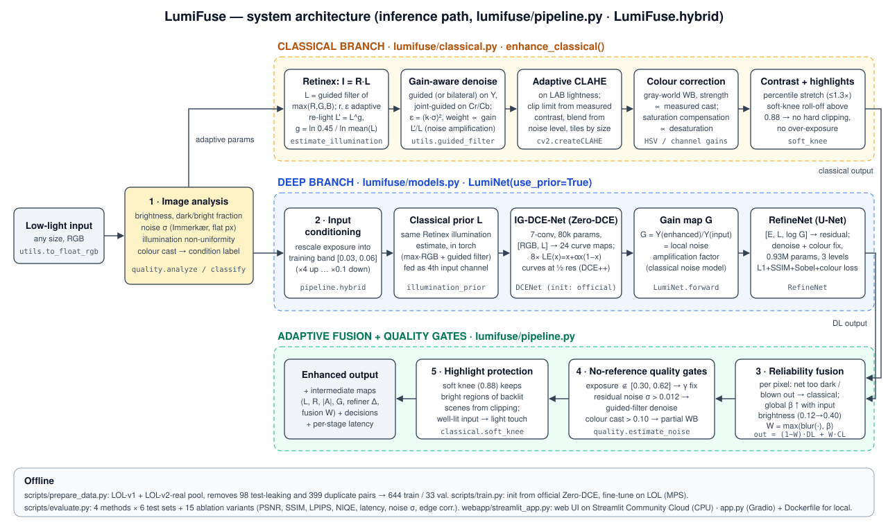
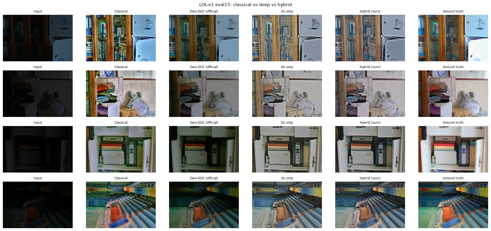

# LumiFuse — Robust Low-Light Image Restoration (Problem P1)

**Live demo:** https://lumifuse.streamlit.app  ·  **Team:** TXX · TEAM_NAME · Dhruv S P (USN1), Harshit Rudresh (USN2)  ·  **Evaluation file:** [`eval_P1_TXX.md`](eval_P1_TXX.md)

LumiFuse restores severely under-exposed, noisy, colour-distorted photos. It runs a fully **adaptive classical
pipeline** (Retinex illumination decomposition, guided/bilateral edge-preserving denoising, CLAHE, colour correction)
and an **illumination-guided deep network** (Zero-DCE curve estimator + a small refinement U-Net, both conditioned on
the classical illumination and amplification maps), then **fuses them per pixel** and checks the result with
**no-reference quality gates**. Every parameter is computed from the image itself; nothing is a fixed constant.



## Results at a glance

<!-- AUTO:glance -->
| Test set (all unseen) | Classical | Zero-DCE | DL-only | **Hybrid** |
|---|---:|---:|---:|---:|
| LOL-v1 eval15 — PSNR / SSIM | 17.06 / 0.661 | 14.86 / 0.563 | 17.23 / 0.734 | 18.09 / 0.737 |
| LOL-v2-real test (100) — PSNR / SSIM | 19.12 / 0.689 | 18.06 / 0.580 | 16.14 / 0.738 | 17.41 / 0.738 |
| Extreme-dark — PSNR / SSIM | 14.99 / 0.317 | 10.34 / 0.083 | 15.78 / 0.490 | 16.01 / 0.501 |
| Non-uniform light — PSNR / SSIM | 16.88 / 0.748 | 16.82 / 0.720 | 13.94 / 0.738 | 16.73 / 0.796 |
| Real DICM+LIME photos — NIQE ↓ | 3.86 | 3.80 | 3.94 | 4.13 |
| CPU latency, 600×400 (ms) | 64 | 276 | 308 | 529 |
<!-- /AUTO:glance -->

**Reading:** the hybrid has the best SSIM on four of five paired test sets (tied on the fifth) and the best PSNR on LOL-v1 and extreme-dark inputs; it beats official Zero-DCE by +3.2 dB on LOL-v1 and +5.7 dB on extreme-dark. The deep-only network wins the perceptual metrics (LPIPS/NIQE) because it smooths less; the classical pipeline wins raw PSNR on LOL-v2 because several LOL-v2 references are darker than average — after matching exposure to the reference (diagnostic only) the hybrid is the best restorer there too (22.30 vs 21.27 dB). Details and the full failure analysis: [`docs/ablation_and_failures.md`](docs/ablation_and_failures.md).

Full tables (6 test sets × 4 methods, 15 ablation variants, latency): [`eval_P1_TXX.md`](eval_P1_TXX.md) ·
design document: [`docs/design_doc.md`](docs/design_doc.md) · ablation & failure analysis:
[`docs/ablation_and_failures.md`](docs/ablation_and_failures.md) · solution report:
[`Hackathon_Solution_Report_P1.md`](Hackathon_Solution_Report_P1.md).



## Quickstart

**One command (Docker):**
```bash
docker build -t lumifuse . && docker run --rm -p 7860:7860 lumifuse
```
Open http://localhost:7860.

**Or with Python 3.11:**
```bash
pip install -r requirements.txt
python app.py                                                     # Gradio web UI on :7860
pip install streamlit && streamlit run webapp/streamlit_app.py    # the deployed Streamlit UI on :8501
python run_inference.py --input_dir ./samples --output_dir ./results/inference --save_maps   # batch CLI
```
`--method` can be `hybrid` (default), `classical`, `dlonly` or `zerodce`. Trained weights are in `weights/` (~4 MB each);
no API keys or secrets are needed.

## Reproduce every number

```bash
pip install -r requirements-dev.txt
# 1. data: LOL-v1 (https://daooshee.github.io/BMVC2018website/), LOL-v2-real, Zero-DCE test photos (DICM/LIME)
bash scripts/get_data.sh
python scripts/prepare_data.py      # leak-free train/val split (drops test-set duplicates)
python scripts/make_synthetic.py    # extreme-dark / non-uniform / moderate synthetic test sets
# 2. train (Apple M1 GPU: ~35 min each; CUDA/CPU also work)
python scripts/train.py --variant hybrid
python scripts/train.py --variant dlonly
# 3. evaluate + tables + figures + eval file
python scripts/evaluate.py && python scripts/evaluate.py --latency
python scripts/summarize.py && python scripts/make_figures.py && python scripts/write_eval_md.py
python -m pytest -q tests           # robustness tests (odd sizes, gray/RGBA/16-bit, black/white frames)
```

## Repository layout

| Path | What it is |
|---|---|
| `lumifuse/classical.py` | Adaptive classical pipeline: Retinex decomposition, illumination re-lighting, gain-aware guided/bilateral denoising, adaptive CLAHE, colour correction, highlight protection |
| `lumifuse/models.py` | `DCENet` (Zero-DCE port, optional prior channel), `RefineNet` (U-Net), `LumiNet` (both + classical priors in torch) |
| `lumifuse/pipeline.py` | `LumiFuse`: classical / Zero-DCE / DL-only / hybrid; adaptive input conditioning, reliability fusion, quality gates |
| `lumifuse/quality.py` | No-reference image analysis (brightness, noise σ, non-uniformity, cast) → condition + parameters |
| `lumifuse/niqe.py`, `lumifuse/metrics.py` | NIQE (MATLAB-equivalent), PSNR, SSIM, LPIPS, edge preservation, noise σ |
| `webapp/streamlit_app.py` | **Deployed web app** (Streamlit Community Cloud): Apple-style UI, before/after slider, intermediate maps, compare-all, error handling |
| `app.py` | Same UI in Gradio (local / Docker) |
| `run_inference.py` | Batch CLI |
| `scripts/` | data prep, synthetic sets, training, evaluation, summary tables, figures, eval-file writer, HF deploy |
| `docs/` | architecture diagram, design document, ablation & failure analysis, demo/viva guide, figures |
| `tests/` | robustness tests |

## Datasets & credits
LOL (Wei et al., BMVC 2018), LOL-v2-real (Yang et al., TIP 2021; HF mirror `okhater/lolv2-real`), DICM and LIME test
photos (via the Zero-DCE repository), Zero-DCE architecture and pretrained weights (Guo et al., CVPR 2020,
github.com/Li-Chongyi/Zero-DCE). NIQE parameters from BasicSR. Datasets are used for research/education only and are
not redistributed here (except 9 small demo samples in `samples/`).
