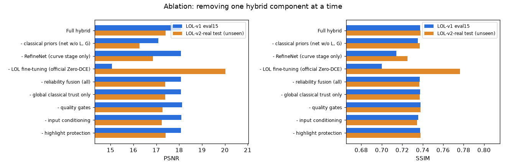
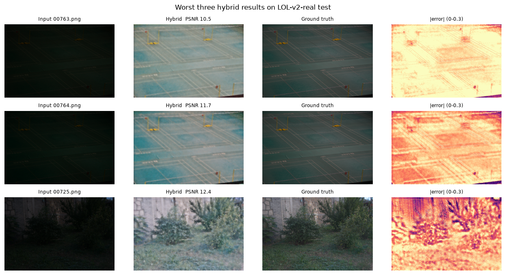

# Ablation study and failure-case analysis

All numbers are produced by `scripts/evaluate.py` → `scripts/summarize.py` → `scripts/fill_docs.py`; each table is
regenerated from `results/summary.json`. Every test set is unseen (leak-free split, see the design doc). Hyper-
parameters were tuned **only** on the validation split and on synthetic variants of validation images
(`scripts/tune_*_val.py`).

## 1. Hybrid ablation — remove one component at a time

### LOL-v1 eval15
<!-- AUTO:abl_lolv1 -->
| Method | PSNR (dB) ↑ | SSIM ↑ | LPIPS ↓ | NIQE ↓ | Noise σ ↓ | Edge corr. ↑ |
|---|---:|---:|---:|---:|---:|---:|
| Full hybrid | 18.09 | 0.7375 | 0.3181 | 4.869 | 0.0018 | 0.8252 |
| - classical priors (net w/o L, G) | 17.09 | 0.7353 | **0.2774** | **3.911** | 0.0024 | 0.8635 |
| - RefineNet (curve stage only) | 18.08 | 0.7144 | 0.3159 | 5.653 | 0.0056 | 0.8687 |
| - LOL fine-tuning (official Zero-DCE) | 15.06 | 0.7002 | 0.2914 | 5.492 | 0.0041 | **0.9003** |
| - reliability fusion (all) | 18.09 | 0.7373 | 0.3181 | 4.875 | **0.0018** | 0.8249 |
| - global classical trust only | 18.09 | 0.7375 | 0.3181 | 4.869 | 0.0018 | 0.8252 |
| - quality gates | **18.13** | **0.7381** | 0.3133 | 4.881 | 0.0018 | 0.8252 |
| - input conditioning | 18.10 | 0.7357 | 0.3164 | 4.857 | 0.0018 | 0.8250 |
| - highlight protection | 18.09 | 0.7375 | 0.3181 | 4.869 | 0.0018 | 0.8252 |
<!-- /AUTO:abl_lolv1 -->

### LOL-v2-real test (100 unseen)
<!-- AUTO:abl_lolv2 -->
| Method | PSNR (dB) ↑ | SSIM ↑ | LPIPS ↓ | NIQE ↓ | Noise σ ↓ | Edge corr. ↑ |
|---|---:|---:|---:|---:|---:|---:|
| Full hybrid | 17.41 | 0.7378 | 0.3542 | 4.716 | 0.0024 | 0.7922 |
| - classical priors (net w/o L, G) | 16.27 | 0.7370 | 0.2966 | **3.975** | 0.0034 | 0.8390 |
| - RefineNet (curve stage only) | 16.85 | 0.7251 | 0.3315 | 5.571 | 0.0078 | 0.8379 |
| - LOL fine-tuning (official Zero-DCE) | **20.02** | **0.7765** | **0.2626** | 5.449 | 0.0055 | **0.9005** |
| - reliability fusion (all) | 17.40 | 0.7369 | 0.3561 | 4.746 | 0.0024 | 0.7915 |
| - global classical trust only | 17.40 | 0.7370 | 0.3560 | 4.742 | 0.0024 | 0.7915 |
| - quality gates | 17.27 | 0.7380 | 0.3556 | 4.718 | 0.0024 | 0.7921 |
| - input conditioning | 17.24 | 0.7346 | 0.3550 | 4.727 | **0.0024** | 0.7914 |
| - highlight protection | 17.41 | 0.7378 | 0.3543 | 4.716 | 0.0024 | 0.7923 |
<!-- /AUTO:abl_lolv2 -->

### Synthetic extreme-dark (exposure ×0.003–0.006)
<!-- AUTO:abl_ext -->
| Method | PSNR (dB) ↑ | SSIM ↑ | LPIPS ↓ | NIQE ↓ | Noise σ ↓ | Edge corr. ↑ |
|---|---:|---:|---:|---:|---:|---:|
| Full hybrid | 16.01 | 0.5007 | 0.7633 | 5.891 | 0.0074 | 0.3848 |
| - classical priors (net w/o L, G) | 16.80 | 0.5296 | **0.7489** | 7.032 | **0.0071** | 0.3743 |
| - RefineNet (curve stage only) | **17.33** | 0.5130 | 0.7572 | 8.895 | 0.0147 | 0.3709 |
| - LOL fine-tuning (official Zero-DCE) | 14.01 | **0.5304** | 0.7515 | 8.710 | 0.0096 | 0.3778 |
| - reliability fusion (all) | 16.01 | 0.5007 | 0.7633 | 5.891 | 0.0074 | 0.3847 |
| - global classical trust only | 16.01 | 0.5007 | 0.7633 | 5.891 | 0.0074 | 0.3848 |
| - quality gates | 15.71 | 0.5009 | 0.7627 | 5.883 | 0.0073 | **0.3853** |
| - input conditioning | 15.95 | 0.5011 | 0.7644 | **5.857** | 0.0072 | 0.3834 |
| - highlight protection | 16.01 | 0.5007 | 0.7633 | 5.891 | 0.0074 | 0.3848 |
<!-- /AUTO:abl_ext -->

### Synthetic non-uniform illumination (gradient + spotlight)
<!-- AUTO:abl_nonu -->
| Method | PSNR (dB) ↑ | SSIM ↑ | LPIPS ↓ | NIQE ↓ | Noise σ ↓ | Edge corr. ↑ |
|---|---:|---:|---:|---:|---:|---:|
| Full hybrid | 16.73 | 0.7963 | 0.2524 | 4.659 | 0.0033 | 0.8680 |
| - classical priors (net w/o L, G) | **16.96** | **0.8028** | 0.2277 | **4.297** | 0.0035 | **0.8794** |
| - RefineNet (curve stage only) | 16.25 | 0.7477 | 0.2775 | 5.502 | 0.0068 | 0.7815 |
| - LOL fine-tuning (official Zero-DCE) | 16.91 | 0.7914 | **0.2240** | 5.335 | 0.0067 | 0.8779 |
| - reliability fusion (all) | 15.64 | 0.7423 | 0.3794 | 5.373 | 0.0011 | 0.7882 |
| - global classical trust only | 15.64 | 0.7423 | 0.3794 | 5.373 | **0.0011** | 0.7882 |
| - quality gates | 16.73 | 0.7963 | 0.2521 | 4.659 | 0.0033 | 0.8680 |
| - input conditioning | 14.98 | 0.7622 | 0.2907 | 4.693 | 0.0034 | 0.8455 |
| - highlight protection | 16.73 | 0.7963 | 0.2524 | 4.659 | 0.0033 | 0.8680 |
<!-- /AUTO:abl_nonu -->

**Reading the ablation.**
* **Classical priors inside the network** (L and G as inputs): +1.00 dB PSNR on LOL-v1 and +1.14 dB on LOL-v2 with
  equal SSIM and lower residual noise; on the synthetic extreme-dark / non-uniform sets the prior-free network is
  slightly better (−0.79 / −0.23 dB), and it is always better on LPIPS/NIQE — the priors push the refiner toward
  stronger denoising.
* **RefineNet:** removing it leaves PSNR on LOL-v1 unchanged but drops SSIM by 0.023 (LOL-v1) to 0.049
  (non-uniform), triples residual noise σ (0.0018 → 0.0056) and worsens NIQE by 0.8–3.0 — the curve stage alone
  brightens but cannot denoise. On extreme-dark it trades 1.3 dB PSNR for half the noise.
* **LOL fine-tuning** (vs. official Zero-DCE weights in the same pipeline): +3.03 dB on LOL-v1 and +2.0 dB on
  extreme-dark, but −2.6 dB on LOL-v2, whose references are darker — the same exposure ambiguity as §4.1.
* **Adaptive input conditioning:** +1.75 dB / +0.034 SSIM on non-uniform light, +0.17 dB on LOL-v2, +0.06 dB on
  extreme-dark.
* **Reliability fusion:** the global-trust term gives +1.09 dB PSNR, +0.054 SSIM and LPIPS 0.379 → 0.252 on
  non-uniform light; the per-pixel under/over-exposure map almost never fires on these sets (identical numbers
  with it removed) — it is a safety net for real photos with blown highlights.
* **Quality gates:** +0.30 dB on extreme-dark, +0.14 dB on LOL-v2, −0.04 dB on LOL-v1.
* **Highlight protection:** no measurable effect here (the paired sets contain no clipped light sources); it
  matters on backlit real photos (`docs/figures/conditions_real.png`).

## 2. Classical-pipeline ablation (incl. fixed vs adaptive parameters)

### LOL-v1 eval15
<!-- AUTO:cabl_lolv1 -->
| Method | PSNR (dB) ↑ | SSIM ↑ | LPIPS ↓ | NIQE ↓ | Noise σ ↓ | Edge corr. ↑ |
|---|---:|---:|---:|---:|---:|---:|
| Classical (adaptive, full) | 17.06 | 0.6612 | 0.3864 | 6.419 | 0.0129 | 0.8106 |
| Classical fixed params | 15.27 | 0.6394 | **0.3281** | **5.376** | 0.0125 | **0.8709** |
| - Retinex | 9.24 | 0.3452 | 0.4735 | 6.387 | **0.0027** | 0.8249 |
| - denoising | 15.90 | 0.3741 | 0.5360 | 9.279 | 0.0515 | 0.7362 |
| bilateral instead of guided | 16.74 | 0.5901 | 0.3862 | 6.378 | 0.0183 | 0.7951 |
| - CLAHE | **17.17** | **0.7069** | 0.3300 | 5.813 | 0.0058 | 0.8380 |
| - colour correction | 17.11 | 0.6649 | 0.3928 | 6.405 | 0.0130 | 0.8108 |
<!-- /AUTO:cabl_lolv1 -->

### LOL-v2-real test
<!-- AUTO:cabl_lolv2 -->
| Method | PSNR (dB) ↑ | SSIM ↑ | LPIPS ↓ | NIQE ↓ | Noise σ ↓ | Edge corr. ↑ |
|---|---:|---:|---:|---:|---:|---:|
| Classical (adaptive, full) | 19.12 | 0.6890 | 0.3995 | 6.581 | 0.0151 | 0.7770 |
| Classical fixed params | 17.64 | 0.6389 | **0.3085** | **5.997** | 0.0211 | **0.8683** |
| - Retinex | 11.40 | 0.3547 | 0.4439 | 6.488 | **0.0033** | 0.8134 |
| - denoising | 16.67 | 0.4015 | 0.5438 | 9.448 | 0.0596 | 0.6955 |
| bilateral instead of guided | 18.38 | 0.6066 | 0.3791 | 6.902 | 0.0219 | 0.7672 |
| - CLAHE | **20.24** | **0.7360** | 0.3694 | 6.126 | 0.0070 | 0.8026 |
| - colour correction | 18.47 | 0.6887 | 0.4240 | 6.575 | 0.0151 | 0.7783 |
<!-- /AUTO:cabl_lolv2 -->

### Synthetic extreme-dark
<!-- AUTO:cabl_ext -->
| Method | PSNR (dB) ↑ | SSIM ↑ | LPIPS ↓ | NIQE ↓ | Noise σ ↓ | Edge corr. ↑ |
|---|---:|---:|---:|---:|---:|---:|
| Classical (adaptive, full) | 14.99 | 0.3168 | 0.9080 | 13.972 | 0.0402 | 0.1923 |
| Classical fixed params | 12.79 | 0.1147 | 1.2824 | 16.448 | 0.1632 | 0.1521 |
| - Retinex | 7.55 | 0.1501 | 1.0055 | **11.329** | **0.0094** | 0.2234 |
| - denoising | 11.69 | 0.0738 | 1.3910 | 25.064 | 0.1772 | 0.0958 |
| bilateral instead of guided | 14.82 | 0.2158 | **0.8115** | 14.205 | 0.0685 | 0.1939 |
| - CLAHE | 13.25 | **0.4662** | 0.8573 | 13.254 | 0.0175 | **0.2400** |
| - colour correction | **15.16** | 0.3187 | 0.9149 | 13.929 | 0.0403 | 0.1927 |
<!-- /AUTO:cabl_ext -->

### Synthetic non-uniform
<!-- AUTO:cabl_nonu -->
| Method | PSNR (dB) ↑ | SSIM ↑ | LPIPS ↓ | NIQE ↓ | Noise σ ↓ | Edge corr. ↑ |
|---|---:|---:|---:|---:|---:|---:|
| Classical (adaptive, full) | 16.88 | 0.7475 | 0.2660 | 5.139 | 0.0092 | 0.8565 |
| Classical fixed params | **17.31** | 0.7340 | 0.2621 | **4.835** | 0.0113 | 0.8301 |
| - Retinex | 13.92 | 0.7087 | **0.2542** | 5.034 | 0.0058 | **0.8907** |
| - denoising | 16.17 | 0.5773 | 0.3659 | 7.315 | 0.0317 | 0.8064 |
| bilateral instead of guided | 16.66 | 0.7078 | 0.2820 | 5.344 | 0.0119 | 0.8358 |
| - CLAHE | 16.66 | **0.7781** | 0.2556 | 5.291 | **0.0043** | 0.8787 |
| - colour correction | 16.87 | 0.7570 | 0.2664 | 5.140 | 0.0091 | 0.8567 |
<!-- /AUTO:cabl_nonu -->

**Reading the classical ablation.**
* **Retinex re-lighting is the core:** removing it costs 7.8 dB on LOL-v1 and 7.4 dB on extreme-dark.
* **Denoising:** removing it costs 1.2–3.3 dB and 0.17–0.29 SSIM, and residual noise σ rises 4×.
* **Guided vs bilateral:** guided filtering is better on PSNR and SSIM on every set (e.g. LOL-v2 19.12/0.689 vs
  18.38/0.607) at similar cost.
* **Adaptive vs fixed parameters:** adaptive wins clearly on LOL-v1 (+1.79 dB, +0.022 SSIM), LOL-v2 (+1.48 dB,
  +0.050 SSIM) and extreme-dark (+2.20 dB, SSIM 0.317 vs 0.115, residual noise 0.040 vs 0.163). Fixed parameters win
  on LPIPS/NIQE for LOL and on PSNR for the non-uniform set (+0.43 dB) — see §4.3: a single global re-lighting
  exponent is pulled up by spotlights.
* **CLAHE** (required by the problem statement) *lowers* PSNR/SSIM against the LOL references, which are
  low-contrast, while raising local contrast that viewers prefer; we keep it with an adaptive clip limit and a
  noise-dependent blend weight rather than at full strength.
* **Colour correction:** +0.65 dB on LOL-v2 (its casts are stronger), neutral elsewhere.

## 3. Design decisions that were tested and rejected (validation split only)

| Idea | Validation result | Decision |
|---|---|---|
| Train curve stage and refiner jointly (no detach) | curve stage collapsed into a green "feature map" (mean R 0.07, G 0.92) — refiner compensated, interpretability lost | detach curve output; curve stage trained by its own loss |
| Classical exposure prior (target brightness from Retinex illumination, α = 0.5 / 0.75 / 1.0) | val PSNR 18.54 → 17.39 / 16.91 / 16.49 | off (`exposure_prior=False`); kept in code for the ablation story |
| Input conditioning upper bound ×2.5 / ×1.6 / ×1.2 / ×1.0 / ×0.8 of the training mean | val 18.47 / 18.53 / **18.53** / 18.34 / 17.95; moderate-light val 15.1 / 16.0 / **16.8** / 17.2 / 17.5 | ×1.2 (best on real validation photos, large gain on moderate light) |
| Global classical trust β over input brightness [lo, hi]: none / [0.12,0.40] / [0.08,0.30] / [0.06,0.20] / [0.05,0.15] | val 18.54 / **18.53** / 18.51 / 18.44 / 18.31; moderate 16.81 / 17.26 / 17.41 / 16.58 / 16.61 (SSIM .754 / **.793** / .797 / .762 / .752); non-uniform SSIM .742 / **.779** / .762 / .738 / .739 | [0.12, 0.40] (keeps validation, best non-uniform) — added after we saw haze on real moderately-dark photos |
| Wider / narrower exposure gate ([0.25,0.65], [0.35,0.60]) | 18.43 / 18.40 vs 18.47 for [0.30,0.62] | keep [0.30, 0.62] |
| Classical: skip contrast stretch when σ > 0.02; denoise floor 0.85 | val 14.98 → 15.47 dB, SSIM 0.42 → 0.54; extreme-dark val 12.2 → 14.0 dB | adopted |
| Classical: noise-scaled filter radius | val 14.98 → 14.79, extreme val 12.23 → 11.67 | rejected |

## 4. Failure cases

### 4.1 Global exposure ambiguity (the main failure)
**Observation.** On LOL-v2-real the hybrid restores structure and noise best (highest SSIM, lowest LPIPS/NIQE)
but its raw PSNR is below the classical pipeline. The losses concentrate in a few scene series (`00724–00730`,
`00750–00752`, `00763–00764`) where the hybrid output is much brighter than the reference:

<!-- AUTO:worst_v2 -->
| Image | Hybrid PSNR | Output brightness | GT brightness |
|---|---:|---:|---:|
| 00763.png | 10.51 | 0.555 | 0.256 |
| 00764.png | 11.68 | 0.511 | 0.256 |
| 00725.png | 12.40 | 0.505 | 0.279 |
| 00724.png | 12.56 | 0.501 | 0.279 |
| 00722.png | 13.05 | 0.503 | 0.297 |
<!-- /AUTO:worst_v2 -->

**Diagnosis.** We rescale each output so that its mean brightness equals the ground truth's and recompute PSNR
("GT-mean", a diagnostic that uses the reference and is therefore never reported as a score):

<!-- AUTO:failure_diag -->
| Test set | Method | PSNR | PSNR after GT-mean exposure match (diagnostic) | Mean abs. exposure error |
|---|---|---:|---:|---:|
| LOL-v1 eval15 | Classical only | 17.06 | 19.65 | 0.094 |
| LOL-v1 eval15 | Zero-DCE (official weights) | 14.86 | 21.06 | 0.177 |
| LOL-v1 eval15 | Deep learning only (LumiNet, no priors) | 17.23 | 19.79 | 0.084 |
| LOL-v1 eval15 | **Hybrid — LumiFuse (proposed)** | 18.09 | 20.98 | 0.081 |
| LOL-v2-real test (unseen) | Classical only | 19.12 | 21.27 | 0.060 |
| LOL-v2-real test (unseen) | Zero-DCE (official weights) | 18.06 | 20.78 | 0.114 |
| LOL-v2-real test (unseen) | Deep learning only (LumiNet, no priors) | 16.14 | 20.88 | 0.121 |
| LOL-v2-real test (unseen) | **Hybrid — LumiFuse (proposed)** | 17.41 | 22.30 | 0.102 |
| Synthetic moderate | Classical only | 17.87 | 20.06 | 0.079 |
| Synthetic moderate | Zero-DCE (official weights) | 18.50 | 19.32 | 0.042 |
| Synthetic moderate | Deep learning only (LumiNet, no priors) | 13.53 | 16.94 | 0.152 |
| Synthetic moderate | **Hybrid — LumiFuse (proposed)** | 17.10 | 20.06 | 0.094 |
| Synthetic extreme-dark | Classical only | 14.99 | 18.85 | 0.129 |
| Synthetic extreme-dark | Zero-DCE (official weights) | 10.34 | 10.49 | 0.241 |
| Synthetic extreme-dark | Deep learning only (LumiNet, no priors) | 15.78 | 18.64 | 0.139 |
| Synthetic extreme-dark | **Hybrid — LumiFuse (proposed)** | 16.01 | 21.00 | 0.123 |
| Synthetic non-uniform | Classical only | 16.88 | 18.23 | 0.064 |
| Synthetic non-uniform | Zero-DCE (official weights) | 16.82 | 17.72 | 0.047 |
| Synthetic non-uniform | Deep learning only (LumiNet, no priors) | 13.94 | 17.00 | 0.139 |
| Synthetic non-uniform | **Hybrid — LumiFuse (proposed)** | 16.73 | 18.94 | 0.078 |
<!-- /AUTO:failure_diag -->

After exposure matching, the hybrid is the best restorer on LOL-v2 and on extreme-dark inputs, i.e. its deficit is
almost entirely **global brightness choice**, not noise, colour or detail.

**Root cause.** "How bright should this night photo be?" is ill-posed from the dark input alone: LOL references were
shot with photographer-chosen exposures, and several LOL-v2 scenes are references at ~0.3–0.4 mean brightness while
the population average is 0.45. The network learns the population-average mapping; PSNR (a log-MSE) punishes a
global offset heavily (a uniform 0.1 error alone caps PSNR at 20 dB). The input-conditioning step, which rescales
inputs into the training exposure range, also removes the absolute-exposure cue.

**Mitigations.** (1) Expose a target-brightness control in the UI (the curve formulation supports it directly —
Zero-DCE's exposure loss takes a target E); (2) exposure-conditioned training (feed the target exposure as an input
channel, sample it from the reference during training); (3) predict exposure from scene semantics (indoor/outdoor,
light sources). We tried using the classical illumination estimate as the target (Section 3) — it hurt on
validation, so it is off.

### 4.2 Residual noise and colour blotches in extremely dark inputs
**Observation.** On the extreme-dark set every method has low SSIM (hybrid ~0.50, classical ~0.32, official Zero-DCE
~0.08); the hybrid output shows low-frequency colour blotches in the darkest regions.

**Root cause.** At ×0.003–0.006 exposure a white surface collects only tens of photons, and 8-bit quantisation maps
the whole shadow range onto 1–5 code values. The information is gone before enhancement; any amplification
reveals quantisation steps and chroma noise. The network was trained on LOL, whose inputs are ~10× brighter.

**Mitigations.** Work on RAW (pre-quantisation) data when available; multi-frame (burst) denoising; train the
refiner with synthetic Poisson–Gaussian noise at extreme gains (the camera model in `scripts/make_synthetic.py`
already exists); add a dedicated chroma-denoising stage weighted by the gain map.

### 4.3 Classical branch on non-uniform light
**Observation.** In the classical ablation, adaptive parameters beat fixed parameters on LOL and extreme-dark, but
fixed parameters score slightly higher PSNR on the synthetic non-uniform set.

**Root cause.** The classical re-lighting exponent g is a single global number derived from the log-average
illumination; with a bright spotlight in frame, the average is pulled up, so the dark side is lifted less than a
fixed g would. Retinex re-lighting is still spatially adaptive (L^g/L), but its *strength* is global.

**Mitigation.** Compute g per region (e.g. on a coarse grid of the illumination map, smoothly interpolated) — a
spatially varying exponent; in the hybrid this is already partly handled by the network and the reliability map.

### 4.4 Real photographs with light sources
Halos are suppressed by the edge-aware guided-filter illumination and the curve TV loss, and highlights by the soft
knee, but strong point lights in the real DICM/LIME photos still show glow spread after enhancement (light
scattering in the original lens/sensor gets amplified with the shadows). Mitigation: protect regions with
L > 0.9 from re-lighting entirely and add a glare-aware loss.
