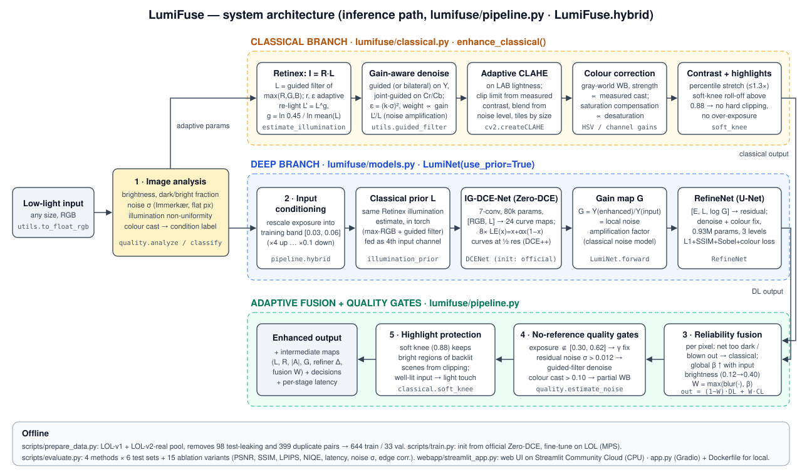
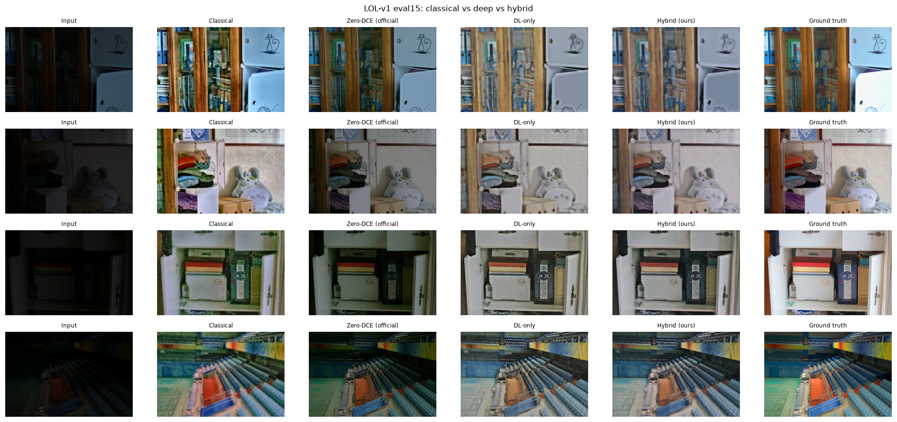
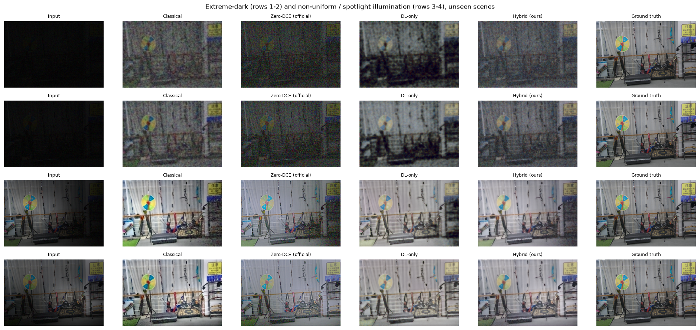
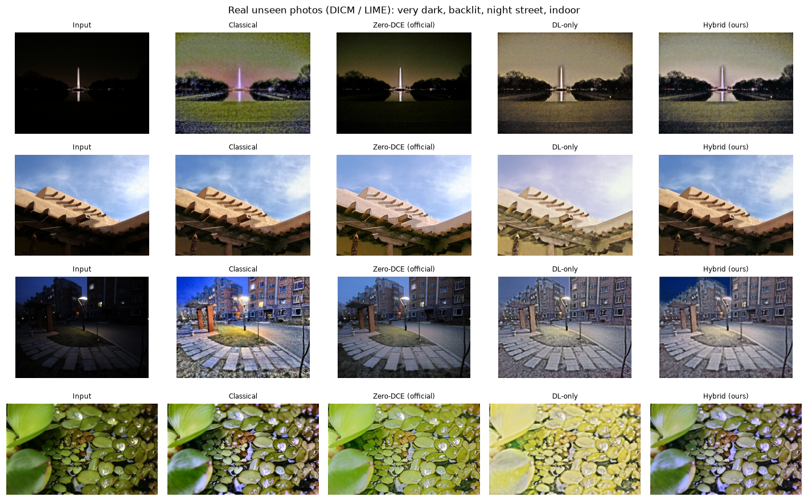
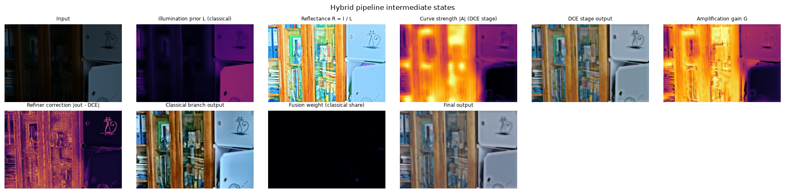
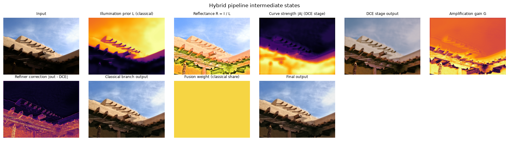
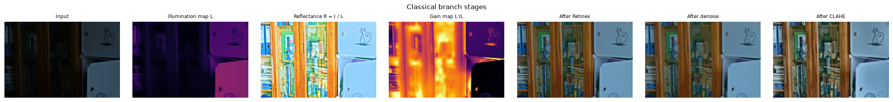

# LumiFuse — Design Document

| Field | Details |
| :--- | :--- |
| **Problem ID** | P1 |
| **Problem Title** | Robust Low-Light Image Restoration and Enhancement |
| **Team** | T81 · Bugweiser · Dhruv S P (1RUA24CSE0133), Harshit Rudresh (1RUA24CSE0157) |
| **Repository** | https://github.com/dhruvo11/lumifuse-lowlight |
| **Live demo** | https://lumifuse.streamlit.app |

This document follows the section structure of the hackathon solution-report template and adds the design detail
behind each decision. The architecture diagram (`docs/architecture.svg`) names the exact modules/functions described here.

---

## 1. Problem Understanding & Solution Strategy

### 1.1 Core technical challenge
Low-light photographs fail in five coupled ways, and fixing one usually worsens another:

| Failure mode | Why it is hard | What makes it worse |
|---|---|---|
| Severe under-exposure | needs 5–20× gain in shadows | a global gain blows out the already-bright regions |
| Sensor noise | shot/read noise sits at the same amplitude as the signal | every unit of gain multiplies noise by the same factor |
| Colour distortion | low photon counts per channel → casts, desaturation | white-balance on noisy channels creates blotches |
| Non-uniform light (lamps, backlight, spotlights) | dark and bright regions in one frame need different curves | fixed curves either under-lift shadows or clip highlights |
| Structure loss | denoising erases texture and edges | strong smoothing → plastic look; weak → grain |

**Constraints we designed for:** must run on a free CPU host (Hugging Face Space, 2 vCPU) in a few seconds; must
work on arbitrary unseen photos (not only the LOL capture setup); must expose *why* it made each decision.

### 1.2 Proposed methodology
Two complementary branches run on every image and are fused adaptively:
* a **classical branch** whose every parameter (illumination smoothing, re-lighting exponent, denoising strength,
  CLAHE clip limit, white-balance strength, saturation gain) is computed from measured image statistics;
* a **deep branch** (Zero-DCE curve estimator + refinement U-Net) that is *conditioned on the classical illumination
  map and amplification map*, initialised from the official Zero-DCE weights and fine-tuned on a leak-free LOL split.

A per-pixel **reliability map** decides where the classical result should override the network (regions the network
left too dark or blew out), and **no-reference quality gates** (exposure, residual noise, colour cast) correct the
fused output only when a measured defect is present. This beats a static baseline because the same image statistics
that describe the degradation drive the correction: dark noisy images get strong re-lighting with strong gain-aware
denoising; well-lit images are left almost untouched; backlit frames keep their highlights.

---

## 2. Technical Architecture & Implementation



### 2.1 Classical algorithmic baseline — `lumifuse/classical.py`

| Stage | Algorithm | Adaptive parameter (computed from the image) |
|---|---|---|
| Illumination estimation | Retinex model **I = R ⊙ L**; L₀ = max(R,G,B), refined by a **guided filter** (edge-aware, so L follows object boundaries and avoids halos) | radius r = min(H,W)/50; ε = (0.1·P90(L₀))² — scale-invariant so a dark image gets the same relative smoothing as a bright one |
| Retinex re-lighting | L′ = L^g, output = I · L′/L (reflectance kept, illumination brightened; dark regions boosted most, bright regions ≈ untouched) | g = ln(0.45)/ln(geomean L), clipped to [0.15, 1] → maps the log-average illumination to the 0.45 brightness of well-exposed references |
| Edge-preserving denoising | **guided filter** on luma (bilateral selectable), **joint guided filter** on chroma using the clean luma as guide (low-light noise is mostly chromatic) | noise σ measured after re-lighting (Immerkær operator on the flattest 50% of pixels); ε = (k·σ)²; per-pixel weight ∝ amplification L′/L so heavily-lifted shadows are filtered hardest; k and floor tuned on the validation split |
| CLAHE | contrast-limited adaptive histogram equalisation on LAB lightness | clip limit = 1 + 2.5·(0.22 − RMS contrast)/0.22 ∈ [1,3]; blend 0.55 if noisy else 0.75; 8×8 tiles (4×4 for small images) |
| Colour correction | gray-world white balance + HSV saturation compensation | WB strength ∝ measured cast (max−min channel mean / mean); saturation gain = 0.30 / mean saturation ∈ [1, 1.35] |
| Contrast & highlights | percentile stretch + **soft-knee** roll-off above 0.88 (never hard-clips) | stretch only if P99.5 < 0.92, gain ≤ 1.3 |

`ClassicalConfig(adaptive=False)` replaces every adaptive value with a fixed constant; this is the
"fixed vs adaptive parameters" ablation.

### 2.2 Deep learning pipeline — `lumifuse/models.py`, `scripts/train.py`

**Architecture (LumiNet, 1.0 M parameters).**
1. **IG-DCE-Net** — the Zero-DCE curve estimator (7 conv layers, 32 channels, 79 k params), extended with a 4th input
   channel carrying the classical illumination prior L. It predicts 8×3 per-pixel curve maps applied iteratively,
   LE(x) = x + α·x·(1−x). Curves are estimated at half resolution and bilinearly upsampled (the Zero-DCE++ trick) —
   curves are smooth, so this is ~4× cheaper with no visible loss. The extra input channel is **zero-initialised**, so
   at step 0 the network is exactly the official Zero-DCE.
2. **RefineNet** — a 3-level U-Net (0.93 M params) that receives the curve output E, the illumination prior L and
   log-gain G = Y(E)/Y(I) and predicts a residual. Curves can only brighten pixel-wise; they cannot remove noise or
   fix colour. G tells the refiner *how much noise each pixel's amplification created* — a classical noise model
   handed to the network. The output conv is zero-initialised, so training starts from the curve result.

**Why Zero-DCE as the base?** Tiny (fast on CPU), curve-based (monotonic, cannot invert tones or hallucinate
structure), official pretrained weights available, and its zero-reference losses let us keep training signal for
unpaired images. A heavier transformer (Retinexformer, ~1.6 M params but ~15 GFLOPs at 256²) would not meet the
CPU latency target on a free host.

**Training data — leak-free split (`scripts/prepare_data.py`).** We pooled LOL-v1 `our485` and LOL-v2-real `Train`
and discovered that **89 of the 100 LOL-v2-real test images are LOL-v1 training images** (pixel-identical). Training
on LOL-v1 as-is would contaminate the LOL-v2 test. We hash every low-light input and drop all pairs that appear in
either test set (98) and all duplicates (399), leaving **644 train / 33 validation** pairs. The validation split —
never the test sets — is used for checkpoint selection and for tuning classical hyper-parameters.

**Losses.**
* Final output (trains RefineNet): L1 + 0.2·(1−SSIM) + 0.1·L1(Sobel) (edge preservation) + 0.1·colour-angle
  (cosine distance between RGB vectors → penalises colour shifts).
* Curve stage (trains IG-DCE-Net): L1 between 4×4-average-pooled output and ground truth (low-pass, because curves
  cannot denoise and should not chase noise) + 0.5·colour-angle + 10·TV(curve maps) (the Zero-DCE illumination-
  smoothness loss; prevents halos).
* The curve output is **detached** before the refiner. Without this, the joint optimisation collapsed the curve
  stage into a feature map (we observed R→0.07, G→0.92 mean outputs) — stage separation keeps the intermediate
  result a real enhancement that we can show and reason about.

**Illumination augmentation for generalisation.** 30% of crops are darkened ×0.3–1.0, 15% brightened ×1–2, 20%
multiplied by a random smooth spatial field (non-uniform light), then re-quantised to 8 bits. Plus random crops
(160²), flips and 90° rotations. AdamW, one-cycle LR (4e-4 refiner, 2e-4 curve net), 4000 iterations, batch 8,
Apple M1 GPU (MPS), ~35 min per model.

**Image-quality-aware strategy.** Quality is measured, not assumed: before inference (`quality.analyze`: brightness,
dark/bright fractions, noise σ, illumination non-uniformity, colour cast → condition label) and after inference
(quality gates on exposure, residual noise and cast; NIQE shown in the UI). The measurements select input
conditioning, classical parameters, fusion weights and post-correction.

### 2.3 Hybrid integration & adaptive mechanism — `lumifuse/pipeline.py`

**Three integration points between classical and learned components**
1. *Classical priors inside the network:* the guided-filter Retinex illumination L conditions the curve estimator;
   L and the amplification map G condition the refiner.
2. *Reliability-weighted fusion of the two branch outputs:*
   `under = clip((0.12 − Y_DL)/0.12) · [Y_CL > Y_DL]`, `over = clip((Y_DL − 0.90)/0.10) · [Y_CL < Y_DL]`,
   `W_px = GaussianBlur(max(under, over), σ = min(H,W)/80)`; a **global trust** term
   `β = clip((mean_in − 0.12)/(0.40 − 0.12), 0, 0.9)` shifts weight to the classical branch as the input gets
   brighter (the network was trained on very dark, noisy LOL inputs; on moderately dark photos its strong denoising
   flattens contrast — we saw this as haze on real DICM/LIME photos); `W = max(W_px, β)`,
   `out = (1−W)·DL + W·CL`. Thresholds tuned on validation + synthetic-validation images.
3. *Classical post-correction gated by no-reference quality:* exposure outside [0.30, 0.62] → luminance-only gamma
   (chroma ratios preserved); residual noise σ > 0.012 → guided-filter denoise; colour cast > 0.10 → partial
   gray-world. Then the soft-knee highlight roll-off.

**Decision logic — amplification vs noise across non-uniform regions.**
* Inputs outside the network's training exposure band are rescaled into it — darker than 0.03 → ×(0.05/mean),
  ≤ 4×; brighter than 0.06 → ×(0.06/mean). Without the downward branch the network over-brightened moderately dark
  photos (output 0.64 vs reference 0.41 mean brightness); tuning on validation raised moderate-light PSNR from
  14.3 to 16.8 dB with no loss on the real validation photos (*adaptive input conditioning*).
* Because curves boost dark pixels more than bright ones, amplification is spatially varying; G exposes it to the
  refiner, and the classical branch filters with weight ∝ L′/L — **noise suppression follows amplification**.
* Bright regions of backlit scenes get g ≈ 1 in the classical branch, the "over" reliability term, and the soft knee
  → highlights are not pushed into clipping.
* Well-lit inputs (mean > 0.35) are blended back towards the original (α ∈ [0.2, 1]) so the system does not
  over-process images that do not need it.

---

## 3. Experimental Benchmarks & Evaluation

Protocol: leak-free split; tuning on validation only; test sets = LOL-v1 eval15 (15), LOL-v2-real test (100),
three synthetic lighting conditions built from 30 unseen LOL-v2 references with a Poisson–Gaussian camera model,
and 74 real DICM/LIME photographs (no reference → NIQE). Metric order follows the problem statement. Latency is a
CPU benchmark (Apple M1, 4 threads, 600×400). Bold = best per column.

### 3.1 Quantitative benchmarks

**LOL-v1 eval15**
<!-- AUTO:main_lolv1 -->
| Method | PSNR (dB) ↑ | SSIM ↑ | LPIPS ↓ | NIQE ↓ | Latency (ms) ↓ | Noise σ ↓ | Edge corr. ↑ |
|---|---:|---:|---:|---:|---:|---:|---:|
| Classical only | 17.06 | 0.6612 | 0.3864 | 6.419 | 64 | 0.0129 | 0.8106 |
| Zero-DCE (official weights) | 14.86 | 0.5627 | 0.3349 | 7.650 | 276 | 0.0170 | **0.8894** |
| Deep learning only (LumiNet, no priors) | 17.23 | 0.7344 | **0.2702** | **3.859** | 308 | 0.0023 | 0.8637 |
| **Hybrid — LumiFuse (proposed)** | **18.09** | **0.7375** | 0.3181 | 4.869 | 529 | **0.0018** | 0.8252 |
<!-- /AUTO:main_lolv1 -->

**LOL-v2-real test (100 unseen)**
<!-- AUTO:main_lolv2 -->
| Method | PSNR (dB) ↑ | SSIM ↑ | LPIPS ↓ | NIQE ↓ | Latency (ms) ↓ | Noise σ ↓ | Edge corr. ↑ |
|---|---:|---:|---:|---:|---:|---:|---:|
| Classical only | **19.12** | 0.6890 | 0.3995 | 6.581 | 64 | 0.0151 | 0.7770 |
| Zero-DCE (official weights) | 18.06 | 0.5798 | 0.3123 | 7.897 | 276 | 0.0215 | **0.8819** |
| Deep learning only (LumiNet, no priors) | 16.14 | **0.7382** | **0.2959** | **3.963** | 308 | 0.0032 | 0.8393 |
| **Hybrid — LumiFuse (proposed)** | 17.41 | 0.7378 | 0.3542 | 4.716 | 529 | **0.0024** | 0.7922 |
<!-- /AUTO:main_lolv2 -->

**Generalisation across illumination conditions (unseen scenes)**

*Moderate low light*
<!-- AUTO:main_mod -->
| Method | PSNR (dB) ↑ | SSIM ↑ | LPIPS ↓ | NIQE ↓ | Latency (ms) ↓ | Noise σ ↓ | Edge corr. ↑ |
|---|---:|---:|---:|---:|---:|---:|---:|
| Classical only | 17.87 | 0.7616 | 0.2542 | 5.776 | 64 | 0.0104 | **0.8733** |
| Zero-DCE (official weights) | **18.50** | 0.7382 | **0.2453** | 6.445 | 276 | 0.0113 | 0.8263 |
| Deep learning only (LumiNet, no priors) | 13.53 | 0.7371 | 0.3141 | **4.454** | 308 | **0.0016** | 0.8317 |
| **Hybrid — LumiFuse (proposed)** | 17.10 | **0.7992** | 0.2619 | 4.685 | 529 | 0.0021 | 0.8581 |
<!-- /AUTO:main_mod -->

*Extremely dark*
<!-- AUTO:main_ext -->
| Method | PSNR (dB) ↑ | SSIM ↑ | LPIPS ↓ | NIQE ↓ | Latency (ms) ↓ | Noise σ ↓ | Edge corr. ↑ |
|---|---:|---:|---:|---:|---:|---:|---:|
| Classical only | 14.99 | 0.3168 | 0.9080 | 13.972 | 64 | 0.0402 | 0.1923 |
| Zero-DCE (official weights) | 10.34 | 0.0826 | 1.2997 | 15.890 | 276 | 0.0910 | 0.1406 |
| Deep learning only (LumiNet, no priors) | 15.78 | 0.4899 | **0.7457** | 7.099 | 308 | 0.0088 | 0.3718 |
| **Hybrid — LumiFuse (proposed)** | **16.01** | **0.5007** | 0.7633 | **5.891** | 529 | **0.0074** | **0.3848** |
<!-- /AUTO:main_ext -->

*Non-uniform / spotlight illumination*
<!-- AUTO:main_nonu -->
| Method | PSNR (dB) ↑ | SSIM ↑ | LPIPS ↓ | NIQE ↓ | Latency (ms) ↓ | Noise σ ↓ | Edge corr. ↑ |
|---|---:|---:|---:|---:|---:|---:|---:|
| Classical only | **16.88** | 0.7475 | 0.2660 | 5.139 | 64 | 0.0092 | 0.8565 |
| Zero-DCE (official weights) | 16.82 | 0.7204 | 0.2737 | 5.630 | 276 | 0.0113 | 0.7980 |
| Deep learning only (LumiNet, no priors) | 13.94 | 0.7379 | 0.3218 | **4.412** | 308 | **0.0018** | 0.8304 |
| **Hybrid — LumiFuse (proposed)** | 16.73 | **0.7963** | **0.2524** | 4.659 | 529 | 0.0033 | **0.8680** |
<!-- /AUTO:main_nonu -->

*Real unpaired photographs (DICM + LIME, no-reference)*
<!-- AUTO:main_real -->
| Method | NIQE ↓ | Latency (ms) ↓ | Noise σ ↓ |
|---|---:|---:|---:|
| Classical only | 3.856 | 64 | 0.0083 |
| Zero-DCE (official weights) | **3.804** | 276 | 0.0073 |
| Deep learning only (LumiNet, no priors) | 3.944 | 308 | **0.0026** |
| **Hybrid — LumiFuse (proposed)** | 4.128 | 529 | 0.0028 |
<!-- /AUTO:main_real -->

**Latency**
<!-- AUTO:latency -->
Measured on Apple M1 CPU, 4 threads, 600x400, mean of 15 LOL images after warm-up.

| Method | Mean (ms) | Std (ms) |
|---|---:|---:|
| Classical only | 64 | 2 |
| Zero-DCE (official weights) | 276 | 8 |
| Deep learning only (LumiNet, no priors) | 308 | 10 |
| **Hybrid — LumiFuse (proposed)** | 529 | 9 |
<!-- /AUTO:latency -->

**Reading the tables.**
* *Fidelity (PSNR/SSIM).* The hybrid has the best SSIM on LOL-v1, moderate, extreme-dark and non-uniform light and
  ties DL-only on LOL-v2 (0.7378 vs 0.7382); it has the best PSNR on LOL-v1 (18.09 dB, +0.86 over DL-only,
  +1.03 over classical, +3.23 over official Zero-DCE) and on extreme-dark inputs (16.01 dB). Our official Zero-DCE
  number on LOL-v1 (14.86 dB) reproduces the paper's reported 14.86 dB, which validates the metric code.
* *Perception (LPIPS/NIQE).* DL-only is best: the classical priors make the hybrid refiner denoise harder (lower
  residual noise σ), which raises PSNR/SSIM but costs some texture — the perception–distortion trade-off. On real
  DICM/LIME photos classical and official Zero-DCE have slightly lower NIQE (3.80–3.86) than the hybrid (4.13);
  NIQE rewards high-frequency texture, including residual noise.
* *Where the hybrid loses.* Raw PSNR on LOL-v2 (17.41 vs classical 19.12) and moderate light (17.10 vs Zero-DCE
  18.50): both are global-exposure choices (§4.1); exposure-matched PSNR puts the hybrid first on LOL-v2 (22.30).
* *Latency.* 0.53 s per 600×400 frame on a laptop CPU (classical 0.06 s, curve-only networks ~0.3 s); the web app
  caps inputs at 768 px so a free 2-vCPU host answers in a few seconds.

### 3.2 Visual outputs & intermediate representations








### 3.3 Ablation study
Summary below; full per-set tables and rejected alternatives in [`ablation_and_failures.md`](ablation_and_failures.md).

**LOL-v2-real test**
<!-- AUTO:abl_lolv2 -->
| Method | PSNR (dB) ↑ | SSIM ↑ | LPIPS ↓ | NIQE ↓ | Noise σ ↓ | Edge corr. ↑ |
|---|---:|---:|---:|---:|---:|---:|
| Full hybrid | 17.41 | 0.7378 | 0.3542 | 4.716 | 0.0024 | 0.7922 |
| - classical priors (net w/o L, G) | 16.27 | 0.7370 | 0.2966 | **3.975** | 0.0034 | 0.8390 |
| - RefineNet (curve stage only) | 16.85 | 0.7251 | 0.3315 | 5.571 | 0.0078 | 0.8379 |
| - LOL fine-tuning (official Zero-DCE) | **20.02** | **0.7765** | **0.2626** | 5.449 | 0.0055 | **0.9005** |
| - reliability fusion (all) | 17.40 | 0.7369 | 0.3561 | 4.746 | 0.0024 | 0.7915 |
| - global classical trust only | 17.40 | 0.7370 | 0.3560 | 4.742 | 0.0024 | 0.7915 |
| - quality gates | 17.27 | 0.7380 | 0.3556 | 4.718 | 0.0024 | 0.7921 |
| - input conditioning | 17.24 | 0.7346 | 0.3550 | 4.727 | **0.0024** | 0.7914 |
| - highlight protection | 17.41 | 0.7378 | 0.3543 | 4.716 | 0.0024 | 0.7923 |
<!-- /AUTO:abl_lolv2 -->

**Synthetic extreme-dark**
<!-- AUTO:abl_ext -->
| Method | PSNR (dB) ↑ | SSIM ↑ | LPIPS ↓ | NIQE ↓ | Noise σ ↓ | Edge corr. ↑ |
|---|---:|---:|---:|---:|---:|---:|
| Full hybrid | 16.01 | 0.5007 | 0.7633 | 5.891 | 0.0074 | 0.3848 |
| - classical priors (net w/o L, G) | 16.80 | 0.5296 | **0.7489** | 7.032 | **0.0071** | 0.3743 |
| - RefineNet (curve stage only) | **17.33** | 0.5130 | 0.7572 | 8.895 | 0.0147 | 0.3709 |
| - LOL fine-tuning (official Zero-DCE) | 14.01 | **0.5304** | 0.7515 | 8.710 | 0.0096 | 0.3778 |
| - reliability fusion (all) | 16.01 | 0.5007 | 0.7633 | 5.891 | 0.0074 | 0.3847 |
| - global classical trust only | 16.01 | 0.5007 | 0.7633 | 5.891 | 0.0074 | 0.3848 |
| - quality gates | 15.71 | 0.5009 | 0.7627 | 5.883 | 0.0073 | **0.3853** |
| - input conditioning | 15.95 | 0.5011 | 0.7644 | **5.857** | 0.0072 | 0.3834 |
| - highlight protection | 16.01 | 0.5007 | 0.7633 | 5.891 | 0.0074 | 0.3848 |
<!-- /AUTO:abl_ext -->

**Reading the ablation.**
* **Classical priors inside the network** (L and G as inputs): +1.00 dB PSNR on LOL-v1 and +1.14 dB on LOL-v2 with
  equal SSIM and lower residual noise; on the synthetic extreme-dark / non-uniform sets the prior-free network is
  slightly better (−0.79 / −0.23 dB), and it is always better on LPIPS/NIQE — the priors push the refiner toward
  stronger denoising.
* **RefineNet:** removing it leaves PSNR on LOL-v1 unchanged but drops SSIM by 0.023 (LOL-v1) to 0.049
  (non-uniform), triples residual noise σ (0.0018 → 0.0056) and worsens NIQE by 0.8–3.0 — the curve stage alone
  brightens but cannot denoise. On extreme-dark it trades 1.3 dB PSNR for half the noise.
* **LOL fine-tuning** (vs. official Zero-DCE weights in the same pipeline): +3.03 dB on LOL-v1 and +2.0 dB on
  extreme-dark, but −2.6 dB on LOL-v2, whose references are darker — the same exposure ambiguity as §4.1.
* **Adaptive input conditioning:** +1.75 dB / +0.034 SSIM on non-uniform light, +0.17 dB on LOL-v2, +0.06 dB on
  extreme-dark.
* **Reliability fusion:** the global-trust term gives +1.09 dB PSNR, +0.054 SSIM and LPIPS 0.379 → 0.252 on
  non-uniform light; the per-pixel under/over-exposure map almost never fires on these sets (identical numbers
  with it removed) — it is a safety net for real photos with blown highlights.
* **Quality gates:** +0.30 dB on extreme-dark, +0.14 dB on LOL-v2, −0.04 dB on LOL-v1.
* **Highlight protection:** no measurable effect here (the paired sets contain no clipped light sources); it
  matters on backlit real photos (`docs/figures/conditions_real.png`).

---

## 4. Failure Modes & Limitations

Full analysis with figures: [`ablation_and_failures.md`](ablation_and_failures.md).

### 4.1 Global exposure ambiguity (main failure)
On a few LOL-v2 scene series the hybrid output is much brighter than the reference. The GT-mean diagnostic
(rescale output brightness to the reference, recompute PSNR — diagnostic only) shows the deficit is exposure, not
restoration:

<!-- AUTO:failure_diag -->
| Test set | Method | PSNR | PSNR after GT-mean exposure match (diagnostic) | Mean abs. exposure error |
|---|---|---:|---:|---:|
| LOL-v1 eval15 | Classical only | 17.06 | 19.65 | 0.094 |
| LOL-v1 eval15 | Zero-DCE (official weights) | 14.86 | 21.06 | 0.177 |
| LOL-v1 eval15 | Deep learning only (LumiNet, no priors) | 17.23 | 19.79 | 0.084 |
| LOL-v1 eval15 | **Hybrid — LumiFuse (proposed)** | 18.09 | 20.98 | 0.081 |
| LOL-v2-real test (unseen) | Classical only | 19.12 | 21.27 | 0.060 |
| LOL-v2-real test (unseen) | Zero-DCE (official weights) | 18.06 | 20.78 | 0.114 |
| LOL-v2-real test (unseen) | Deep learning only (LumiNet, no priors) | 16.14 | 20.88 | 0.121 |
| LOL-v2-real test (unseen) | **Hybrid — LumiFuse (proposed)** | 17.41 | 22.30 | 0.102 |
| Synthetic moderate | Classical only | 17.87 | 20.06 | 0.079 |
| Synthetic moderate | Zero-DCE (official weights) | 18.50 | 19.32 | 0.042 |
| Synthetic moderate | Deep learning only (LumiNet, no priors) | 13.53 | 16.94 | 0.152 |
| Synthetic moderate | **Hybrid — LumiFuse (proposed)** | 17.10 | 20.06 | 0.094 |
| Synthetic extreme-dark | Classical only | 14.99 | 18.85 | 0.129 |
| Synthetic extreme-dark | Zero-DCE (official weights) | 10.34 | 10.49 | 0.241 |
| Synthetic extreme-dark | Deep learning only (LumiNet, no priors) | 15.78 | 18.64 | 0.139 |
| Synthetic extreme-dark | **Hybrid — LumiFuse (proposed)** | 16.01 | 21.00 | 0.123 |
| Synthetic non-uniform | Classical only | 16.88 | 18.23 | 0.064 |
| Synthetic non-uniform | Zero-DCE (official weights) | 16.82 | 17.72 | 0.047 |
| Synthetic non-uniform | Deep learning only (LumiNet, no priors) | 13.94 | 17.00 | 0.139 |
| Synthetic non-uniform | **Hybrid — LumiFuse (proposed)** | 16.73 | 18.94 | 0.078 |
<!-- /AUTO:failure_diag -->

*Root cause:* target brightness is ill-posed from a dark input; the network learns the population-average exposure
of LOL references (0.45) and PSNR penalises global offsets heavily. *Mitigation:* target-exposure control in the UI
and exposure-conditioned training; a classical exposure prior was tried and rejected on validation.

### 4.2 Extreme darkness
Tens of photons per pixel and 8-bit quantisation leave 1–5 code values in the shadows; amplification reveals chroma
blotches. *Mitigation:* RAW/burst input, Poisson–Gaussian noise training at extreme gains.

### 4.3 Classical branch on non-uniform light
A single global re-lighting exponent is pulled up by bright spotlights, so fixed parameters can score higher PSNR on
the non-uniform set. *Mitigation:* spatially varying exponent on a coarse illumination grid.

### 4.4 Light sources in real photos
Amplified lens glare around strong point lights. *Mitigation:* exclude L > 0.9 from re-lighting, glare-aware loss.

### 4.x Ethics and responsible use
* **Not a forensic tool.** The refiner is a learned prior: it can smooth away or (rarely) invent fine texture. Outputs
  must not be used as evidence (e.g. identifying people or licence plates in CCTV) or for medical decisions.
* **Privacy.** The web app processes images in memory and never stores or logs them; no analytics are collected
  (`GRADIO_ANALYTICS_ENABLED=False` in Docker).
* **Dual use.** Low-light enhancement can aid surveillance. We publish only a general photo-enhancement tool, with no
  face/person detection components.
* **Data and bias.** LOL/LOL-v2 are mostly indoor scenes captured with a few cameras; performance on other sensors,
  night sky, underwater or medical imagery is unverified. Skin-tone rendering under strong casts was not evaluated
  separately.
* **Licences.** LOL, LOL-v2, DICM and LIME are research datasets used under their academic terms; they are not
  redistributed beyond nine demo thumbnails. Zero-DCE weights are used under the authors' release.
* **Honest metrics.** No ground-truth-mean brightness correction ("GT-mean" trick) is used; test sets are never used
  for model selection; contaminated test images were removed from training rather than reported as "unseen".

---

## 5. Deployment & Quickstart Guide

* **Runtime:** Streamlit web app (`webapp/streamlit_app.py`) on Streamlit Community Cloud (free CPU; requirements in
  `webapp/requirements.txt`, CPU-only torch wheels), PyTorch CPU inference, models cached with `st.cache_resource`.
  The same UI in Gradio 6 (`app.py`) for local use and the Docker image (`Dockerfile`, python:3.11-slim, CPU torch)
  for one-command runs. CLI: `run_inference.py`. (Hugging Face Spaces now requires a paid plan to host Gradio apps,
  so we deploy on Streamlit Cloud; `scripts/deploy_hf.py` remains for a PRO account.)
* **UI states:** examples for every lighting condition; progress indicator while processing; friendly error messages
  for missing / unreadable / too-small files (no stack traces); large inputs are downscaled to ≤1024 px (≤640 px in
  compare-all mode) to keep latency within a few seconds; outputs downloadable as PNG.
* **No secrets** are needed or committed.

```bash
docker build -t lumifuse . && docker run --rm -p 7860:7860 lumifuse          # one command
pip install -r requirements.txt && python app.py                               # or plain Python (Gradio)
pip install streamlit && streamlit run webapp/streamlit_app.py                 # deployed Streamlit UI
python run_inference.py --input_dir ./samples --output_dir ./results/inference --save_maps
```

---

## Appendix A — Requirements traceability

| Requirement (problem statement) | Where it is implemented | Evidence |
|---|---|---|
| A. Illumination estimation & decomposition | `classical.estimate_illumination`, `models.illumination_prior` | intermediate maps "Illumination map L", "Reflectance" |
| A. Retinex-based enhancement | `classical.enhance_classical` stage 1–2 | ablation "− Retinex" |
| A. CLAHE | `classical.enhance_classical` stage 4 | ablation "− CLAHE" |
| A. Bilateral / guided edge-preserving denoising | `utils.guided_filter`, `classical` stage 3 (`denoiser="guided"/"bilateral"`) | ablation "bilateral instead of guided", "− denoising" |
| A. Contrast & colour correction | `classical` stages 5–6 | ablation "− colour correction" |
| A. Adaptive parameter selection | `quality.analyze` + per-stage formulas | ablation "Classical fixed params" |
| B. Low-light architecture (Zero-DCE) | `models.DCENet`, `load_official_zerodce` | "Zero-DCE (official)" rows |
| B. Fine-tune / adapt on available data | `scripts/train.py`, leak-free `prepare_data.py` | ablation "− LOL fine-tuning" |
| B. Generalisation across illumination | illumination augmentation; tests on LOL-v2 unseen, 3 synthetic conditions, DICM/LIME | §3 tables |
| B. Image-quality-aware enhancement | `quality.analyze`, quality gates, NIQE in UI | ablation "− quality gates" |
| C. Classical illumination + DL restoration | `LumiNet(use_prior=True)` | ablation "− classical priors" |
| C. Adaptive select/combine mechanism | reliability fusion in `pipeline.hybrid` | ablation "− reliability fusion"; fusion-weight map |
| C. Preserve edges, limit noise amplification | gain-aware filtering, Sobel loss, G-conditioned refiner | Noise σ and edge-corr. columns |
| C. Extremely dark & non-uniform inputs | input conditioning, soft knee, reliability "over" term | synthetic extreme / non-uniform tables |
| Adv. 1 adaptive (not fixed) parameters | everything above | fixed-vs-adaptive ablation |
| Adv. 2 compare ≥3 approaches | classical / Zero-DCE / DL-only / hybrid | §3.1 |
| Adv. 3 ablation | 8 hybrid + 7 classical variants | §3.3 |
| Adv. 4 minimise over-exposure, colour shift, detail loss | soft knee, colour-angle loss, colour gate, edge loss | §3, §4 |
| Adv. 5 unseen images | LOL-v2 (leak-free), synthetic, DICM/LIME | §3.1–3.2 |
| Metrics: PSNR, SSIM, LPIPS, NIQE, latency, noise, edges | `lumifuse/metrics.py`, `scripts/evaluate.py` | eval file |
